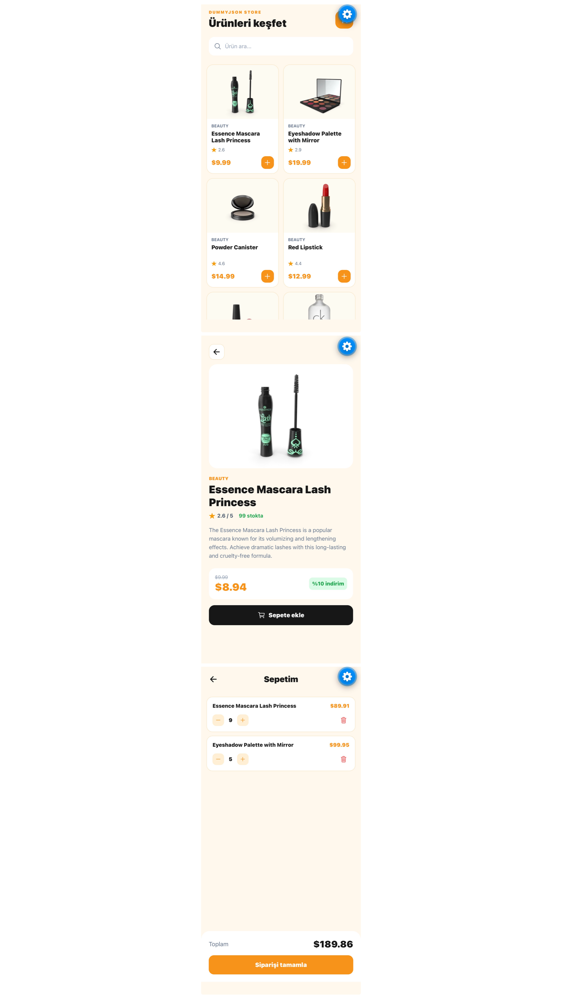

# Hafta 10 - API Tabanlı E-Ticaret Uygulaması

React Native, Expo ve Expo Router kullanılarak geliştirilen üç sayfalı API tabanlı bir e-ticaret uygulamasıdır. Uygulama, [DummyJSON](https://dummyjson.com/) REST API üzerinden güncel ürün verilerini çekerek ürün listeleme, arama, ürün detayı ve sepet işlemleri sunar.


## Ozellikler

- DummyJSON API'den urunleri listeleme
- Urun adina gore anlik arama
- Yenileme (pull-to-refresh) destegi
- Dinamik Expo Router urun detay sayfasi
- Urun puani, aciklama, stok ve kategori bilgileri
- Indirim oranina gore hesaplanan indirimli fiyat
- Context API ile ortak sepet durumu
- Sepete urun ekleme
- Sepetteki urunleri silme
- Urun miktarini artirma ve azaltma
- Toplam urun adedi ve toplam tutar hesaplama
- Bitcoin temali turuncu, krem ve siyah arayuz

## Ekranlar

| Urun listesi | Urun detayi | Sepet |
|:---:|:---:|:---:|
| Urunleri listeler ve arama yapar | API'den gelen urun bilgilerini gosterir | Miktar ve toplam tutari yonetir |

### Uygulama Goruntusu



## Kullanilan Teknolojiler

- React Native
- Expo
- Expo Router
- JavaScript
- React Hooks: `useState`, `useEffect`, `useContext`
- Context API
- Fetch API ile REST veri cekme
- DummyJSON REST API
- Expo Vector Icons

## API

**Urun listesi**

```text
https://dummyjson.com/products
```

**Urun arama**

```text
https://dummyjson.com/products/search?q=phone
```

**Urun detayi**

```text
https://dummyjson.com/products/{id}
```

## Klasor Yapisi

```text
hafta-10/
├── app/
│   ├── _layout.js
│   ├── index.js
│   ├── sepet.js
│   └── urun/
│       └── [id].js
├── components/
│   └── UrunKarti.js
├── context/
│   └── SepetContext.js
├── app.json
├── index.js
└── package.json
```

## Kurulum

### Gereksinimler

- Node.js 22.13 veya daha yeni surum
- npm
- Expo Go uygulamasi

### Projeyi calistirma

```bash
git clone https://github.com/Sqap85/hafta-10-e-ticaret.git
cd hafta-10-e-ticaret
npm install
npm start
```

Terminalde olusan QR kodunu telefonunuzdaki **Expo Go** uygulamasi ile okutabilirsiniz.

Web icin:

```bash
npm run web
```

## Mobil Calistirma

Android veya iOS cihazinizda Expo Go uygulamasini acip terminaldeki QR kodunu tarayin. Bilgisayar ve telefonun ayni yerel agda olmasi gerekir.

## Kodda Karsilasilan Temel Kavramlar

| Kavram | Kullanım |
|---|---|
| `useState` | Arama metni, urunler ve yukleme durumunu yonetir |
| `useEffect` | API istegini ve arama gecikmesini tetikler |
| `useContext` | Tum ekranlarda ortak sepet verisine erisir |
| `props` | Urun bilgilerini urun karti bileşenine aktarir |
| `fetch` ve `async/await` | DummyJSON REST API'den veri ceker |
| Expo Router | Liste, detay ve sepet sayfalari arasinda gezinir |

## Test Kontrol Listesi

- [x] API'den urun verileri geliyor
- [x] Urun arama calisiyor
- [x] Urun kartina tiklaninca dinamik detay sayfasi aciliyor
- [x] Urun sepete ekleniyor
- [x] Sepetten urun siliniyor
- [x] Urun miktari artirilip azaltilabiliyor
- [x] Toplam tutar hesaplanıyor
- [x] Indirimli fiyat urun detayinda goruntuleniyor
- [x] Bitcoin temasi tum ekranlara uygulanmis

## Gelistirici

Bu proje Mobil Programlama laboratuvar ödevi kapsamında geliştirilmiştir.
